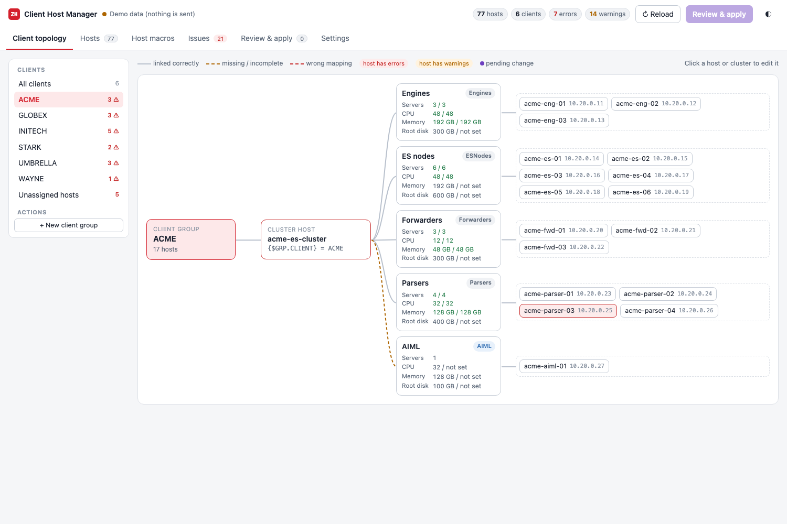

# Zabbix Host Manager

Browser tools for managing Zabbix **hosts, host macros, client/role mapping and templates** across many hosts, built for Elasticsearch/SIEM deployments where each client has a cluster host plus Engines, ESNodes, Forwarders and Parsers.



## Tools

### `host-manager.html`: client host manager (Zabbix API)
Connects to the Zabbix API (7.0+) with an API token and loads hosts, groups, linked templates and host macros.

- **Client topology:** client group → cluster host → role groups → hosts, with requested vs allocated servers, CPU, memory and disk per role. Wrong mappings are highlighted.
- **Hosts:** assign client and role per host or in bulk. Host groups, `{$CLIENT}`/`{$ROLE}`/`{$GRP.CLIENT}` and the expected templates change together.
- **Host macros:** spreadsheet-style editing (paste from Excel, CSV import/export), and a macro picker that lists the macros from linked templates.
- **Issues:** checks for unassigned hosts, hosts in several clients, macro/group mismatches, a `{$GRP.CLIENT}` that matches no group, missing templates, empty sizing macros and macro typos. Most have a one-click fix.
- **Review & apply:** every change is staged and shown as a diff first. Writes are batched (one call per group or template, macros in arrays of up to 50) and paced, to keep load on the Zabbix API low.
- **Demo mode:** try it without a Zabbix server.

How a host belongs to a client: the host is in host group `<CLIENT>` plus one role group, and that client's cluster host has `{$GRP.CLIENT}=<CLIENT>`. That is the filter the *Elasticsearch Cluster by HTTP SISA* template uses in its formulas. Role groups, macro names and template names can be changed under **Settings**.

### `macro-manager.html`: template macro editor (offline)
Load a Zabbix template export (JSON) to bulk-edit macro values, types and descriptions. Macro names are locked. It finds broken macro→item mappings and wrong item value types, and exports a file that is byte-identical except for the fields you changed.

## Deploy

```bash
./deploy/deploy.sh
```

This builds and starts an nginx container that runs without root privileges and adds:
- HTTPS (self-signed certificate on first start)
- a proxy to your Zabbix API, so the browser never calls Zabbix directly and cross-origin blocking can't happen
- an optional allow-list of client networks

See [deploy/README.md](deploy/README.md) for the settings.

Without Docker, open `host-manager.html` in a browser, or serve the folder with `python3 -m http.server`.

## Files

| Path | What |
|---|---|
| `host-manager.html` | Client host manager (single file, no dependencies) |
| `macro-manager.html` | Template macro editor (single file, no dependencies) |
| `deploy/` | Dockerfile, compose file, one-click deploy script |
| `zbx_export_templates_ES_Elastic_http_linux.json` | Original template export (Zabbix 7.0) |
| `zbx_export_templates_ES_Elastic_http_linux_fixed.json` | Same export with the macro→item mapping fixes applied |
| `screenshots/` | UI screenshots (`host-manager/` uses demo data) |

## Security

- Nothing is written to Zabbix until you click **Apply** and confirm. Every action runs with the permissions of your API token.
- The token is stored only if you choose to remember it, either until the tab closes or permanently on that device. Use the permanent option only on your own machine, with a token that has an expiry date.
