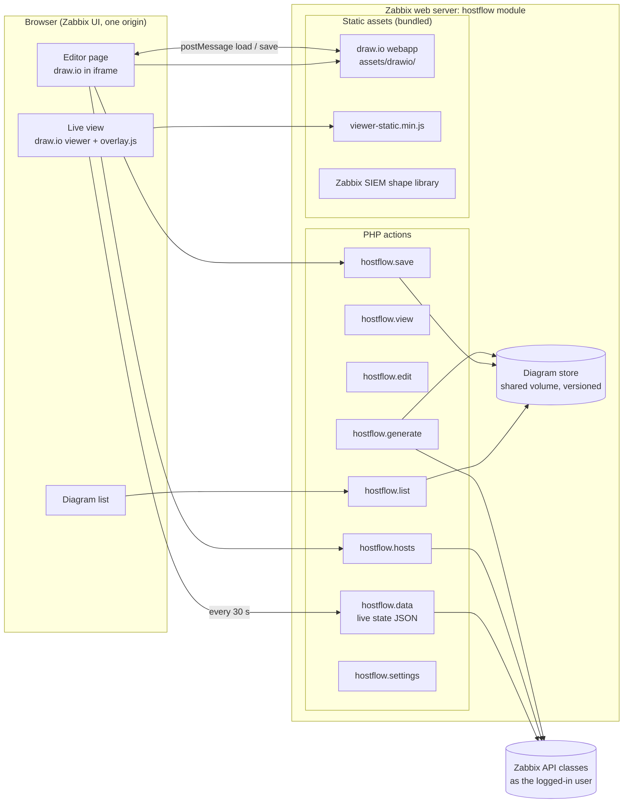
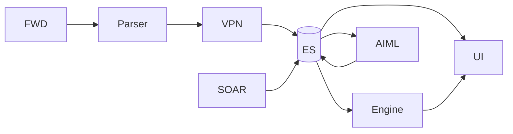

# Plan: Host Flow, editable draw.io diagrams as a Zabbix module

Changed 18 Oct 2026: no version history (one file per diagram, Discard instead of restore), a flow is created automatically for each client, and the main page shows flows on the left and the live flow on the right.

Status: implemented in `hostflow/` and `hostflow-widget/` (2026-10-17) · Target: Zabbix 7.0 LTS · see `hostflow/README.md`

## 1. Goal

A Zabbix frontend module that adds **Monitoring → Host Flow**, where you can:

- **Draw and edit** architecture diagrams with the full draw.io editor. **It is bundled inside the module**, so there's nothing extra to host.
- **Generate** a diagram automatically from Zabbix: clients, cluster hosts, components (Forwarders, Parsers, VPN, ES, UI, Engine, AIML, SOAR), proxies and the data flow between them. Then edit it freely.
- **Watch it live.** Every shape shows the host's **current IP**, **availability** and **active problems**, coloured by severity, and refreshes on its own.
- **Click through** from any shape to that host's problems, latest data or dashboard.

**Not in scope:** Host Manager (client/role assignment, macros, duplicate renamer) becomes a **separate Zabbix module** with its own plan. Native Zabbix maps stay as they are (§9 covers importing one).

## 2. Decisions

| # | Topic | Decision |
|---|---|---|
| 1 | Diagram storage | **Versioned files on a shared volume** |
| 2 | Data flow | **Your pipeline, fully configurable** (§6): FWD → Parser → VPN → ES → UI · ES → Engine → UI · ES ⇄ AIML · SOAR → ES |
| 3 | Who edits | **Admin and Super admin**. Users view only, enforced on the server |
| 4 | Host Manager | **A separate Zabbix module**, outside this plan |
| 5 | draw.io hosting | **Bundled inside the module**; no separate container or host |
| 6 | VPN / UI and other components | **Mixed or other group names.** Each component maps to one or more host groups (or a host tag) in the module settings |

## 3. What users see

| View | Who | What |
|---|---|---|
| **Diagram list** | Everyone with module access | Name, client, number of hosts, worst current problem, last edited by and when |
| **Live view** | Everyone with module access | Read-only diagram with live IPs, colours and problem badges. Auto-refresh, full screen, zoom and fit, "only problems" highlight |
| **Edit** | Admin and Super admin | The draw.io editor, the Zabbix SIEM shape library and a "Link to host" panel. Save keeps a new version |
| **Generate** | Admin and Super admin | Pick a client (or all), a layout (§6) and options, then preview and open in the editor |
| **Settings** | Super admin | Component → host-group mapping, data-flow edges, refresh interval, label templates |
| **Dashboard widget** (phase 4) | Everyone | One diagram on any Zabbix dashboard, live |

## 4. Components and where their data comes from

Components are **configurable**. These defaults can all be changed in Settings:

| Component | Default mapping (Settings → Components) | Live data shown |
|---|---|---|
| **Client** | A host group named after the client | Host count, worst problem among its hosts |
| **Cluster host** | Has the template *Elasticsearch Cluster by HTTP SISA*, with `{$GRP.CLIENT}` = client | IP, cluster status, problems |
| **FWD** (Forwarder) | groups `Forwarders` | Per host: IP:port, availability, enabled/maintenance, problems |
| **Parser** | groups `Parsers` | same |
| **VPN** | *no default; set the group(s) or a tag in Settings* | same |
| **ES** (ES nodes) | groups `ESNodes` | same |
| **UI** | *no default; set the group(s) or a tag in Settings* | same |
| **Engine** | groups `Engines` | same |
| **AIML** | groups `AIML` | same |
| **SOAR** | groups `SOAR` | same |
| **Zabbix server and proxies** | `proxy.get`, plus each host's *monitored by* | Proxy IP, last seen, how many hosts it monitors |

Each component can match by:
- **one or more host groups** (for example `VPN` *or* `VPN-Gateways`);
- **a host tag** (for example `evp-role: vpn`);
- **a template.**

A host can match more than one component; the generator places it in the first match, following the order in Settings.

**IPs are never typed onto a shape.** A shape stores only the Zabbix `hostid`, and the IP is read from Zabbix on every refresh.

## 5. Architecture



**Key points**

- **draw.io lives inside the module.** Its webapp is static HTML and JavaScript (Apache-2.0), shipped under `hostflow/assets/drawio/` and served by Zabbix's existing nginx/Apache like any other module asset.
  - It is the same origin as Zabbix, so the iframe works with Zabbix's default `X-Frame-Options: SAMEORIGIN`.
  - It runs with `stealth=1&offline=1`, so there are no cloud storage options, plugins or internet requests. The Java servlets in draw.io aren't needed: saving goes to our PHP action, and export is done in the browser.
- **Zabbix data uses the logged-in session.** All of it comes from `API::Host()`, `API::Problem()`, `API::Proxy()`, `API::Item()` and `API::Settings()`, run **as the logged-in user**, so Zabbix permissions decide what each person sees. No API tokens.
- **Light API load.** Each live refresh is one module request, making **3–4 API calls in total** (`host.get` with interfaces, `problem.get`, `proxy.get`, and `item.get` only when links show traffic). This doesn't grow with the size of the diagram.

### Module layout

```
hostflow/
  manifest.json                 manifest_version 2.0, namespace HostFlow
  Module.php                    Monitoring → Host Flow; Settings only for Super admin
  actions/  ListAction  ViewAction  EditAction  DataAction  SaveAction
            GenerateAction  HostsAction  SettingsAction  SettingsUpdateAction
  lib/      DiagramStore.php    versioned files, revisions, locking, ACL
            Components.php      component → groups/tags/templates resolution
            FlowGraph.php       configurable data-flow edges (§6)
            LiveState.php       one batched API read → per-host state
            Generator.php       Zabbix model + flow graph → draw.io XML
            DrawioXml.php       safe XML build/parse (no external entities)
  views/    hostflow.list.php  hostflow.view.php  hostflow.edit.php  hostflow.settings.php
  assets/drawio/                pinned draw.io webapp release (static)
  assets/js/  viewer-static.min.js  editor-bridge.js  overlay.js
  assets/shapes/zabbix-siem.xml   shape library (FWD, Parser, VPN, ES, UI, Engine, AIML, SOAR, Cluster, Proxy, …)
  assets/css/hostflow.css
  install.sh                    copies the module, creates the storage dir, checks permissions
  tests/
```

- **Skeleton:** copy it from **`zabbix-host-inventory`**, an existing clean Zabbix 7.0 module with tests, `install.sh` and the menu-injection pattern.
- **draw.io version:** pin it in `assets/drawio/VERSION`. A `tools/update-drawio.sh` script downloads a release, strips what isn't needed (servlets, the Electron build, extra languages if wanted) and checks its SHA-256.

## 6. Data flow: your pipeline, configurable

Default flow graph, editable in **Settings → Data flow**:



- **Data model:** a list of components (id, label, shape, column and row hint) plus a list of edges (`from → to`, label, style, optional item to show on the link). The defaults are your edges above.
- **Changing it:** add or remove components (for example a new "Kafka" tier), add, remove or reverse edges, rename labels, change the shapes. Saved as JSON in the module settings. A diagram stores a copy of the flow it was generated from, so later changes don't silently change existing diagrams.
- **Loops** such as ES → AIML → ES are drawn as a return arrow, and the layout ignores them when it works out the columns.

**Generated layouts**

| Layout | Shape of the diagram |
|---|---|
| **Data flow** (default) | Columns follow the flow graph: FWD → Parser → VPN → ES → UI, with Engine/AIML/SOAR placed around ES. Each component is a container holding its hosts (or "12 hosts, 2 down" when collapsed). |
| **Client hierarchy** | Client → cluster host → component groups → hosts |
| **Monitoring path** | Zabbix server → proxies → the hosts each proxy monitors |
| **Combined** | Data flow in the centre, with the monitoring path as a side lane |

**Options:**
- one client or all clients, with each client in its own container shape;
- show individual hosts, or groups only with counts;
- include disabled hosts;
- a label template.

**"Update from Zabbix"** re-runs the generator on an existing diagram:
- adds new hosts inside the right component;
- marks removed hosts with a dashed outline (it never deletes them);
- keeps everything drawn by hand.

Shapes are matched on `zbx_hostid`.

## 7. draw.io integration

### Shapes linked to Zabbix

Each shape carries custom properties:

| Property | Meaning |
|---|---|
| `zbx_hostid` | The Zabbix host this shape represents |
| `zbx_component` | Component id (FWD, VPN, …), for container shapes |
| `zbx_itemid` | Optional, on links: the item for traffic or latency |
| `zbx_label` | Label template |

**Label placeholders**, filled in live: `%name%` `%host%` `%ip%` `%port%` `%status%` `%availability%` `%problems%` `%severity%` `%proxy%` `%value%`.

### Editor

1. The iframe loads `assets/drawio/index.html?embed=1&proto=json&stealth=1&offline=1&spin=1&libraries=1&noExitBtn=1&saveAndExit=0`.
2. On `init`, the module sends `{action:'load', xml}` and adds the **Zabbix SIEM shape library**.
3. The **"Link to host"** panel, next to the iframe:
   - searches through `hostflow.hosts`, with the user's permissions applied;
   - filters by component;
   - stamps `zbx_hostid` and a default label onto the selected shape.
4. On a `save` event, the XML goes with its **revision number** to `hostflow.save`. If someone else saved first, you get *"changed by X at 10:42, reload or save as a copy"*.

### Live view

- Renders with the bundled **static viewer**. The editor isn't loaded.
- `overlay.js` polls `hostflow.data?id=…` and updates the graph model:
  - **Colour = worst active problem severity**, using the severity colours **configured in Zabbix** (`settings.get`).
  - Unacknowledged Disaster or High problems **pulse**. A host in maintenance gets a wrench badge. Disabled hosts are grey. If the agent is unreachable, the border is red and dashed.
  - **Badge:** the problem count.
  - **Tooltip:** host, IP:port, proxy, and the top 5 problems.
  - **Click:** a menu with Problems, Latest data, Graphs and Host dashboard.
  - **Component containers** take the worst state of their members, and show a count such as *"4/4 up"*.
  - **Links:** a link can show the last value of an item, for example EPS or traffic.
- Hosts the viewer has no permission for show **"no access"**. Their names and IPs are never sent to that browser.
- **Refresh:** 30 s by default (10–300 s), plus a manual refresh. Polling stops while the tab is hidden.

## 8. Storage, versions and permissions

**Storage:** files on a shared volume. The default is `/var/lib/zabbix-hostflow/` (configurable). With several web nodes, all of them mount the same volume.

```
/var/lib/zabbix-hostflow/
  diagrams/<id>/meta.json        name, client, owner, acl, revision, updated_by, updated_at
  diagrams/<id>/rev-000042.drawio
  audit/hostflow-audit.jsonl
```

- **Saving:** a temporary file is written, then renamed into place. A per-diagram lock stops two saves happening at once.
- **Versions:** the last 20 revisions are kept, with *restore* and a *linked-hosts diff*.
- **Backup:** include the directory in your normal file backups.

**Who can do what**

| Action | Allowed for |
|---|---|
| Open Host Flow | Zabbix **user role** → *Access to modules* (no custom permission system) |
| Live view | Anyone with module access; hosts outside their permissions show "no access" |
| Edit, generate, delete, restore | **Admin and Super admin**, checked in every write action on the server |
| Settings (components, flow) | **Super admin** |
| Restrict one diagram | Optional ACL by user group |

**Audit:** saves, deletes, restores and settings changes go to `hostflow-audit.jsonl`, one JSON object per line: who, when, diagram, revision, hosts added and removed.

## 9. Native Zabbix maps

- **Import a map** (phase 4): `map.get` reads elements, coordinates, links and shapes, and turns them into draw.io cells. Host elements keep their `hostid`, so they are live straight away.
- **Link from maps:** add a URL on any native map element that opens the matching Host Flow diagram.
- **Publish to a native map** (optional, later): a one-way export of hosts and links. Lossy, because styles and free shapes are dropped.

## 10. Security

- **Every write action is POST-only, with Zabbix CSRF tokens.** Edit and generate rights are checked on the server.
- **Diagram XML is checked on the server** before it is stored:
  - size limit (5 MB);
  - no DTD or external entities;
  - only `mxfile`/`mxGraphModel` content allowed;
  - script, `javascript:` links and event attributes stripped from labels and links.
- **The storage folder is outside the web root** and is never served directly.
- **The bundled draw.io makes no outside requests** (`stealth=1&offline=1`). A CSP check is part of the tests.
- **Live data responses** carry only the hosts on that diagram that the user is allowed to see.

## 11. Testing

| What | How |
|---|---|
| **Lab** | Zabbix 7.0 Docker stack (reuse `ElasticVue-Pro-portable-win64/deploy/zabbix/stack/docker-compose.yml`, which already mounts modules) |
| **Test data** | A seed script that creates 6 clients × ~70 hosts across FWD/Parser/VPN/ES/UI/Engine/AIML/SOAR under **mixed group names and tags** (to test the mapping), plus 2 proxies and trapper items. Problems are raised and resolved on demand. |
| **Unit tests** (PHP) | Component resolution (groups, tags, templates, order); flow graph incl. the ES ⇄ AIML loop; generator output; XML validation (XXE, size, script stripping); revision conflicts; regenerate-keeps-edits |
| **Permission tests** | User / Admin / Super admin: edit, save, generate and settings refused on the server where they should be; hosts outside permissions never appear in `hostflow.data` |
| **End-to-end** (Playwright) | Generate → edit → save → live view: an IP change appears after one refresh; a new problem colours the shape and shows a badge; acknowledging it stops the pulse; click-through opens the right page; **no requests leave the Zabbix origin** |
| **Load** | A 500-shape diagram: one refresh under 1 s on the server; exactly 3–4 API calls per refresh |

## 12. Phases

| Phase | Scope | Done when |
|---|---|---|
| **1. Module and editor** | Skeleton, menu, bundled draw.io, list / create / edit / save / versions on the shared volume, XML validation, CSRF, Admin-only writes, audit log | An Admin draws and saves inside Zabbix with no external hosting; a User can open but not edit |
| **2. Live view** | `hostflow.data`, overlay: IPs, availability, problem colours, badges, tooltips, click-through, Zabbix severity colours | IPs and problems update in place within one refresh |
| **3. Generate and components** | Settings: component mapping (groups/tags/templates) and data-flow editor; the Data-flow and Client-hierarchy layouts; Link-to-host panel; shape library; Update from Zabbix | Your FWD → Parser → VPN → ES → UI pipeline generated for a 70-host client in one click, editable afterwards |
| **4. Extras** | Monitoring-path layout, link items (EPS/traffic), Zabbix map import, dashboard widget, PNG/SVG export | Widget on a dashboard; an existing Zabbix map imported |

## 13. Still to confirm

- **VPN and UI host groups or tags.** Which names should be the defaults? Settings can be filled in later.
- **The shared volume path,** if not `/var/lib/zabbix-hostflow/`. Also: do you run one Zabbix web node or several?
